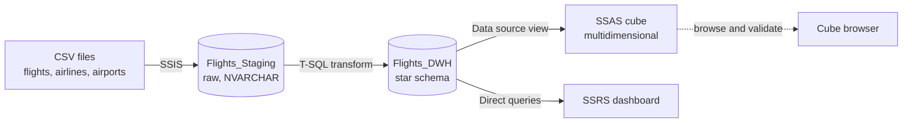
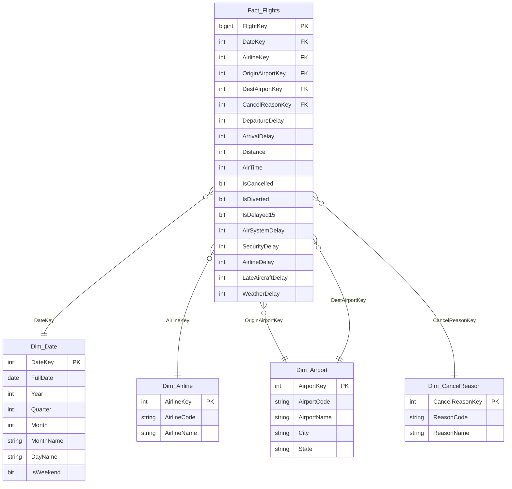

# US Flight Delays 2015: End-to-End Microsoft BI Solution


A complete business intelligence pipeline built on the Microsoft BI stack. It ingests **5.8 million US domestic flights** (2015), models them in a **star schema data warehouse**, exposes them through a **multidimensional SSAS cube**, and presents the findings in an **SSRS dashboard**.


---

## Table of contents

1. [Business questions](#business-questions)
2. [Architecture](#architecture)
3. [Dataset](#dataset)
4. [Data warehouse design](#data-warehouse-design)
5. [ETL with SSIS](#etl-with-ssis)
6. [SSAS cube](#ssas-cube)
7. [SSRS dashboard](#ssrs-dashboard)
8. [Key insights](#key-insights)
9. [Data quality and validation](#data-quality-and-validation)
10. [Repository structure](#repository-structure)
11. [How to run](#how-to-run)
12. [Lessons learned](#lessons-learned)
13. [Tech stack](#tech-stack)

---

## Business questions

- Which airlines and airports perform worst on arrival delay?
- What is the best time of day and month to fly?
- Why do flights get delayed, and what causes cancellations?
- How do delays behave across the year?

## Architecture



| Layer | Purpose | Technology |
|---|---|---|
| Source | Raw CSV files | Kaggle dataset |
| Staging | Untransformed copy, all columns as text | SSIS, SQL Server |
| Warehouse | Typed, conformed star schema | T-SQL |
| Semantic | Measures, dimensions, calculated members | SSAS Multidimensional |
| Presentation | Interactive dashboard | SSRS |

## Dataset

[2015 Flight Delays and Cancellations](https://www.kaggle.com/datasets/usdot/flight-delays) (US Department of Transportation, via Kaggle).

| File | Rows | Description |
|---|---|---|
| `flights.csv` | 5,819,079 | Flights with schedule, actual times, delays, cancellation and diversion flags (31 columns) |
| `airlines.csv` | 14 | Airline codes and names |
| `airports.csv` | 322 | Airport codes, names, city, state, coordinates |

> The CSV files are not included in this repository (`flights.csv` is about 500 MB). Download them from Kaggle and place them in a local `Data/` folder.

## Data warehouse design



Design decisions:

- **Grain:** one row per flight.
- **Role-playing dimension:** `Dim_Airport` is used twice, as origin and as destination.
- **Unknown member:** a `-1` airport row keeps flights whose airport code is numeric and missing from `airports.csv`, so no fact rows are lost.
- **Time handling:** `HHMM` text values (for example `0005`) are converted to minutes after midnight, and `2400` is treated as `0`.
- **Surrogate keys** on all dimensions, and a date key in `YYYYMMDD` format.
- **Typed columns:** staging stores everything as text, and the warehouse load applies `TRY_CAST` so bad values become `NULL` instead of failing the load.

## ETL with SSIS

**Staging load** (`Flights_ETL` project):

- One Flat File connection per source file, UTF-8 (code page 65001), all columns as `DT_WSTR`.
- Column widths matched to the staging tables to avoid truncation warnings.
- Fast-load OLE DB destinations with `Keep nulls` enabled and a 100,000-row batch size, so empty fields land as real `NULL` values and not empty strings.
- Row counts verified against the source files after every load.

**Warehouse load** (T-SQL scripts in `SQL/`):

- Dimensions loaded first, then the fact table with joins on business keys.
- `LEFT JOIN` plus `ISNULL(..., -1)` on airports for the unknown-member pattern.

## SSAS cube

Multidimensional project `Flights_SSAS`:

- **Measure group:** `Fact Flights` (delay measures, taxi times, air time, distance, delay causes, row count).
- **Dimensions:** Date (with a Year > Quarter > Month hierarchy), Airline, Airport (origin and destination roles), Cancel Reason.
- **Calculated members:** `Avg Arrival Delay` and `Avg Departure Delay`, defined as the delay sum divided by the flight count.
- Full cube process: **5,819,079 rows read in about 11 seconds**.

> Note: the calculated averages divide by all flights, including cancelled ones whose delay is `NULL`. They are therefore slightly lower than the SQL averages used in the SSRS dashboard (for example Delta: 0.186 in SQL vs 0.185 in the cube).

## SSRS dashboard

Report `Airline Performance.rdl` with KPI cards and seven visuals:

| Visual | Question answered |
|---|---|
| KPI cards | Total flights, average arrival delay, cancellations, diversions |
| Bar: arrival delay by airline | Who performs best and worst? |
| Line: monthly average delay | When in the year are delays worst? |
| Column: delay by scheduled departure hour | What is the best time to fly? |
| 100% stacked bar: delay causes by airline | Why are flights delayed? |
| Bar: top 10 airports by arrival delay | Which airports struggle most? |
| Pie: cancellation reasons | Why are flights cancelled? |

The report queries the warehouse directly with T-SQL, so averages ignore `NULL` values correctly.

## Key insights

| Insight | Evidence |
|---|---|
| **Morning flights beat the clock.** Flights scheduled between 5 and 7 AM arrive early on average, and delays build up through the day. | -3.8, -2.6 and -1.5 minutes at 5, 6 and 7 AM, peaking at **10.1 minutes around 7 PM** |
| **Delays cascade.** Late aircraft is the largest delay cause for most airlines, meaning one late flight pushes back the next. | Dominant segment in the 100% stacked chart, about half of Southwest's delay minutes |
| **Weather drives cancellations, not delays.** | Weather is **54.4%** of cancellations (48,851 flights) but a small share of delay minutes |
| **Spirit and Frontier are the least punctual.** Alaska and Delta lead. | Spirit **14.5**, Frontier **12.5**, Alaska **-1.0**, Delta **0.2** minutes average arrival delay |
| **Delay is seasonal.** Winter storms and summer traffic create two peaks. | February **8.3** minutes, June **9.6** minutes, September and October **-0.8** |
| **Regional airports top the delay ranking.** | McGhee Tyson (10.6), LaGuardia (10.4), Colorado Springs (10.2) among airports with more than 5,000 arrivals |

Overall: **5,819,079** flights, **4.4** minutes average arrival delay, **89,884** cancellations, **15,187** diversions.

## Data quality and validation

| Check | Result |
|---|---|
| Staging row counts (flights / airlines / airports) | 5,819,079 / 14 / 322 |
| Warehouse fact rows vs staging | 5,819,079, no rows lost in joins |
| Cancelled and diverted flags | 89,884 and 15,187 |
| Empty fields stored as `NULL` | Confirmed |
| Cube rows read at process time | 5,819,079 |
| Cube totals by airline vs SQL | Match (for example Southwest 1,261,855) |

Known limitation: **486,165 flights (8.4%)** have a numeric origin airport code that does not exist in `airports.csv`. They are mapped to the `Unknown Airport` member. A code-to-airport mapping table would remove this gap.

## Repository structure

```
.
├── SSIS/Flights_ETL/          # Staging load packages
├── SSAS/Flights_SSAS/         # Multidimensional cube project
├── SSRS/Flights_SSRS/         # Report project (Airline Performance.rdl)
├── SQL/
│   ├── 01_create_staging.sql
│   ├── 02_create_dwh.sql
│   ├── 03_load_dwh.sql
│   └── 04_validation.sql
├── Images/                    # Dashboard and architecture screenshots
├── Data/                      # (not tracked) place the Kaggle CSV files here
└── README.md
```

## How to run

**Prerequisites:** SQL Server, SSIS, SSAS (multidimensional mode), and SSRS, plus Visual Studio with the Integration Services, Analysis Services, and Reporting Services project extensions.

1. Download the dataset from Kaggle into `Data/`.
2. Run `SQL/01_create_staging.sql` to create `Flights_Staging`.
3. Open `SSIS/Flights_ETL`, update the three Flat File connection paths, and run the package. Confirm the row counts.
4. Run `SQL/02_create_dwh.sql` then `SQL/03_load_dwh.sql` to build and load `Flights_DWH`.
5. Run `SQL/04_validation.sql` and compare with the table above.
6. Open `SSAS/Flights_SSAS`, set the data source to your server, then **Deploy** and **Process**.
7. Open `SSRS/Flights_SSRS`, set the shared data source to `Flights_DWH`, and **Preview** or deploy the report.

## Lessons learned

- **Stage everything as text.** Loading raw data as `NVARCHAR` and casting in the warehouse removes code page and type mismatch failures in SSIS.
- **A fact table is a measure group, not a dimension.** The cube wizard can create a dimension from the fact table by default, so unselect it.
- **Averages need care in OLAP.** Summing a score or delay and dividing by a total count includes `NULL` rows, so keep the count and the sum aligned.
- **Plan for unknown members.** A `-1` dimension row preserves facts that would otherwise fail an inner join.
- **Validate at every layer.** Matching row counts after staging, warehouse, and cube catches silent data loss early.

## Tech stack

SQL Server · SSIS · SSAS (Multidimensional) · SSRS · T-SQL · MDX · Visual Studio

